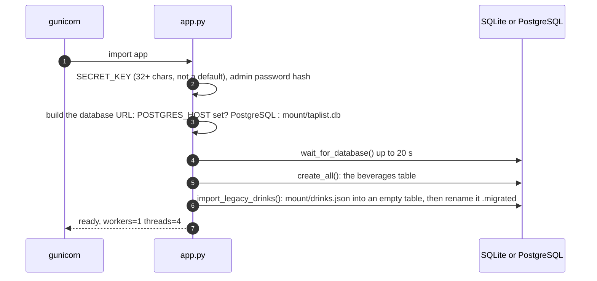

# Architecture Overview

Homebrew Taplist is a Flask application that shows the drinks of a home bar as a page of colored cards: the beers on tap, the bottles and the spirits. A logged-in admin adds and removes drinks, and replaces the background and the favicon. The beer color is drawn from its SRM value. The whole application is one Python file (`app.py`), four templates and one stylesheet.

| Page | What it covers |
|---|---|
| [Beverages & Admin](beverages-and-admin.md) | The data model, the attributes and their limits, how a card is built (SRM color), the admin actions, image handling, the `drinks.json` migration |
| [Security & Deployment](security-and-deployment.md) | Login, CSRF, headers, secrets, environment variables, database choice, the container, Compose, HTTPS |
| [Recommendations](recommendations.md) | Findings and ideas |
| [Guides](guides/README.md) | Step by step: a new beverage attribute |

The pages describe the code as it is. Suggested changes are collected on [Recommendations](recommendations.md).

---

## Design principles

* **Meant for a home network, built as if it were not.** The page is public and read only; everything that changes data sits behind one admin login, with CSRF protection, validated input and re-encoded images.
* **Data in the database, pictures on disk.** Beverages are rows (SQLite by default, PostgreSQL optional). Images, the background and the favicon live in the `mount/` folder; the database only keeps an image's path. The mounted folder is the whole state of a default install.
* **Almost no JavaScript.** The admin page is plain forms plus a small script that fills the delete dropdown. The public page has only a picture viewer (click a picture to enlarge it). Both scripts carry the CSP nonce.
* **Fail at start, not at run time.** Weak secrets or an unreachable database stop the container immediately.

---

## Folder layout

```
app.py              Everything: secrets, headers, database, login, public page, admin actions, helpers
srm_colors.json     SRM value (0.0 to 50.0 in 0.1 steps) to hex color
templates/          base.html (admin layout, Bootstrap 5 from a CDN with SRI), index.html (the public cards),
                    admin.html (the forms), login.html
static/style.css    Styles of the public page
mount/              The default background.png and favicon.png, img/ for uploaded pictures (.gitkeep)
example/            Screenshots for the README: admin, desktop, mobile
dockerfile          Two stage Alpine image, no shell, non-root, gunicorn
Changelog.md        Release notes of 2.0 and 2.1
.docker             name=homebrew-taplist, version=2.2
requirements.in/.txt, generate_requirements.sh   Dependencies and the hash-pinned lock file
.claude/            Local Claude Code settings (git-ignored)
```

---

## Routes

| Route | Auth | What it does |
|---|---|---|
| `GET /` | none | The taplist page: three sections of cards |
| `GET /mount/<path>` | none | Serves **images only** (`.png .jpg .jpeg .gif .webp`) from `mount/`; anything else is a 404, so the database file stays private |
| `GET /login`, `POST /login` | none; POST limited to 5 per minute and 20 per hour | Sign in |
| `POST /logout` | admin | Sign out |
| `GET /admin` | admin | The forms |
| `POST /admin/add_item` | admin | Add a beverage with its picture |
| `POST /admin/delete_item` | admin | Delete a beverage by ID |
| `POST /admin/update_background_image` | admin | Replace `mount/background.png` |
| `POST /admin/update_favicon` | admin | Replace `mount/favicon.png` |

## What happens on start



## Dependencies

`flask`, `flask-login`, `flask-wtf`, `flask-limiter`, `pillow`, `gunicorn`, `sqlalchemy`, `psycopg[binary]`; Bootstrap 5.3.2 for the admin pages comes from jsDelivr with a Subresource Integrity hash.
